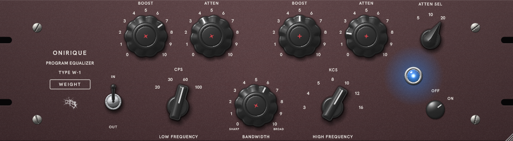

# Onirique Weight

Un égaliseur à lampes dans l'esprit de l'égaliseur de programme passif des
années 50 (EQP-1A) : la même façade, les mêmes réglages aux mêmes places, et
son fameux tour du bas. Deux caractères en plus du modèle :

- **le bas pèse** : plus le Low Boost monte, plus les lampes épaississent la
  basse de leurs harmoniques (surtout la deuxième), chaudes et rondes ;
- **le haut respire** : le High Boost est une cloche prolongée par une étagère
  très large au-dessus, à la manière des bandes d'air des égaliseurs de
  mastering ; les aigus ne passent pas par les lampes et restent propres.

La façade est celle de l'original, peinte d'un rouge sourd ; potards, sélecteurs,
levier, vis et lampe sont rendus en relief, pixel par pixel, sous une lumière de
studio fixe : un potard qu'on tourne garde ses reflets en place, comme sur une
photo de l'appareil.

VST3 (Windows, macOS) et Audio Unit (macOS). Mono ou stéréo (les deux côtés
liés). Traitement à fréquence doublée : 4 échantillons de latence à 48 kHz,
annoncés à l'hôte.



---

## Les réglages

| Section | Réglage | Ce qu'il fait |
|---|---|---|
| LOW | Boost | jusqu'à +13,5 dB sous la fréquence, et le poids des lampes avec |
| | Atten | jusqu'à -17,5 dB, en pente plus douce, centrée plus haut |
| | CPS | 20, 30, 60 ou 100 Hz, la même pour les deux |
| HIGH | Boost | jusqu'à +18 dB : la cloche (85 %) et l'air au-dessus (45 %) |
| | Bandwidth | la largeur de la cloche, de SHARP à BROAD ; elle se resserre quand on pousse |
| | KCS | 3, 4, 5, 8, 10, 12 ou 16 kHz |
| | Atten | une étagère douce, jusqu'à -16 dB |
| | Atten Sel | 5, 10 ou 20 kHz |
| | EQ (levier) | en bas, les courbes à plat, la couleur des lampes reste |
| | Power | éteint, le signal tel qu'il est entré ; la lampe bleue l'indique |

Le tour du bas : Boost et Atten ensemble, à 60 Hz et à 10, donnent environ
+4,7 dB à 30 Hz et -4,8 dB vers 200 Hz ; à 5 et 3, +3 dB et -1,8 dB.

Survoler ou tourner un réglage affiche sa valeur (et ce qu'elle vaut en dB) juste
à côté de lui ; un double-clic le remet à zéro.

---

## État du projet

| Partie | État |
|---|---|
| Moteur (courbes, air, lampes, poids, glisse des réglages) | fait, testé hors ligne (`test_weight`) |
| Plugin complet (fréquence doublée, latence, bypass) | testé hors ligne (`weight_snapshot --selftest`) |
| Interface | vérifiée sur capture (`weight_snapshot`) |
| Licence ONIRIQUE (`onirique-weight`) | intégrée ; aucun produit de ce nom au catalogue pour l'instant |
| Écoute dans un DAW | **pas encore faite** |

Les courbes ont été placées par raisonnement à partir de la fiche de l'original,
pas mesurées sur un appareil ; la quantité de couleur des lampes reste à régler
à l'oreille.

---

## Construire

JUCE 9.0.3 est cherché dans `JUCE/`, puis dans `../PitchBox/JUCE` : les plugins
de la gamme partagent la même copie.

```bash
cmake -B build -A x64
cmake --build build --config Release --parallel
ctest --test-dir build -C Release --output-on-failure
```

Le plugin sort dans `build/OniriqueWeight_artefacts/Release/VST3/OniriqueWeight.vst3`.

Une capture de l'interface, sans hôte :

```bash
cmake --build build --config Release --target weight_snapshot
build/Release/weight_snapshot capture.png 1.5
```

Sur GitHub, chaque push construit Windows et macOS ; les plugins sont déposés sur
les branches `ci-build-Windows` et `ci-build-macOS`, les journaux sur `ci-logs-*`.

`License/` est copié tel quel de `plugin-license/` du dépôt ONIRIQUE CENTRAL, et
`Source/ui/OniriqueWindowSize.h` de `plugin-ui/` : ils ne se modifient que là-bas.
